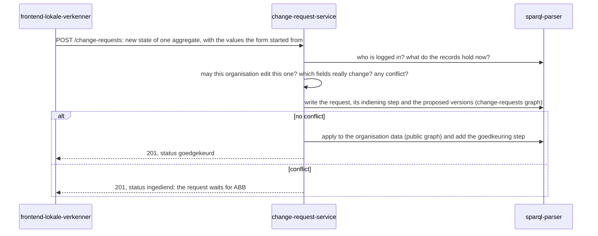
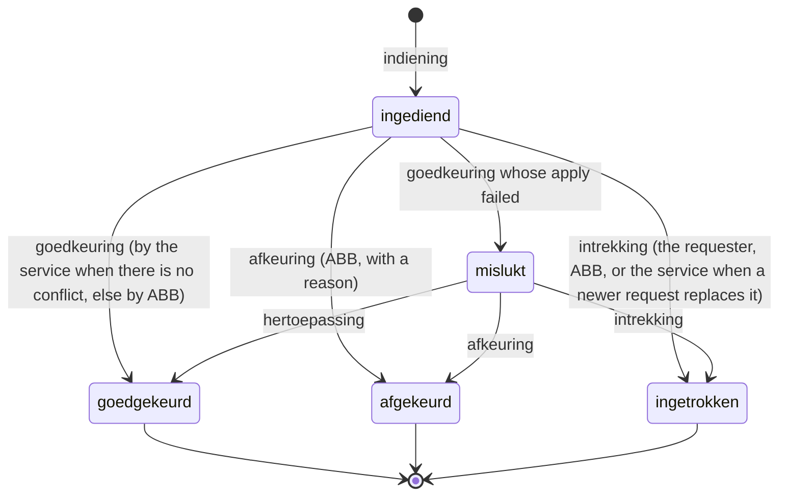
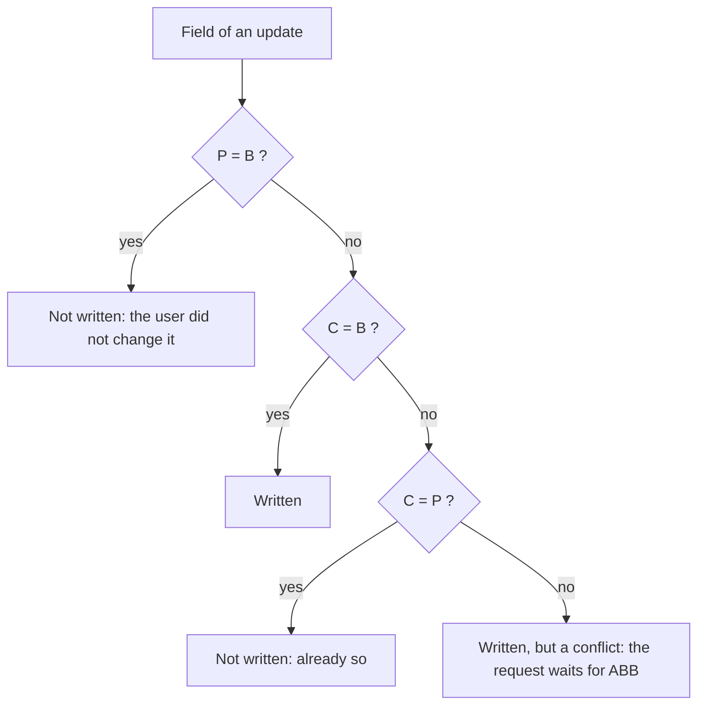
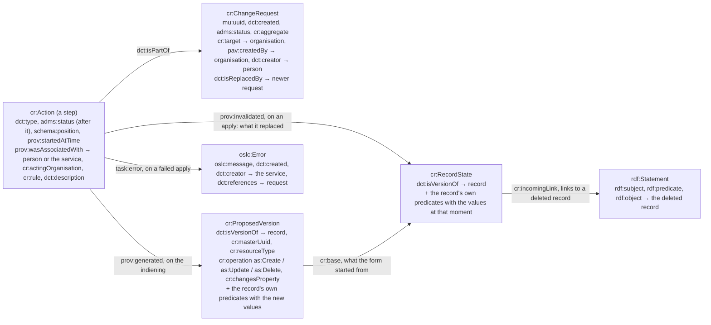
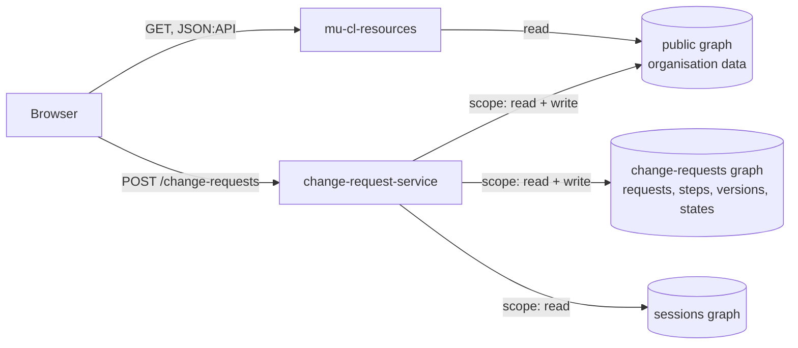

# change-request-service

Every edit of organisation data in app-lokale-verkenner is a **change request**. The frontend sends the new
state of a group of records. This service checks it, keeps it as history, and applies it to the
organisation data: at once when that is safe, or after ABB approves it.

Built on [mu-javascript-template](https://github.com/mu-semtech/mu-javascript-template) 1.9.1.
Detail lives in `docs/`: [API](docs/api.md), [what is stored](docs/data-model.md),
[authorization](docs/authorization.md), [development](docs/development.md).

## In short

- **One write path.** Nobody writes organisation data directly, not even ABB. The resource routes
  are read-only. This service is the only writer, through a sparql-parser scope. No sudo.
- **A request tells a story.** It carries a trail of steps (indiening, goedkeuring, afkeuring,
  intrekking, hertoepassing): who did what, when, and under which rule. Its status is the status
  of its last step.
- **Applied at once when safe.** With every update the frontend sends the values its form started
  from. A field nobody else changed since is applied right away. A field somebody else changed in
  the meantime is a conflict: the request waits for ABB, who approves or rejects it.
- **The request is the history.** It keeps the proposed version of every record, the values the
  form started from, and the values an approval replaced. Nothing is copied between graphs.
- **No second model.** The service reads the same `config/resources/*.json` files as mu-cl-resources.



## Words used here

| Word | Meaning |
| --- | --- |
| Aggregate | A group of records that is edited together: the kerngegevens of an organisation, or one vestiging with its address and contact points. Configured, see [Configuration](#configuration). |
| Target | The organisation a request is about. |
| Requesting organisation | The organisation the user is logged in for. It may edit itself; ABB may edit everyone. |
| Step | Something done to a request: indiening, goedkeuring, afkeuring, intrekking, hertoepassing. Stored as a `cr:Action`. |
| Proposed version | The new state of one record inside a request: only the fields it changes. |
| Base | The value a field had when the form was loaded. The frontend sends it with the proposal. |
| Record state | The values some fields of a record had at one moment: what a form started from, or what an approval replaced. |
| Conflict | A field where the proposal disagrees with the current value, and the current value is no longer what the form started from. |
| Competing request | Another pending request that proposes something else for the same field. |

## The life of a request



- **Submit** (`POST /change-requests`): the service checks the policy, works out which fields really
  change, writes the request, and then either applies it (step 2: goedkeuring by the service) or
  holds it (status `ingediend`).
- **Decide** (`POST /change-requests/:id/steps`): ABB approves or rejects a held request. Before an
  approval the conflicts are checked again against the current data; ABB approves with the token
  of the conflicts it reviewed, so it never overrides a change it did not see. The requester can
  withdraw its own request.
- **Replace**: a newer request of the same organisation that rewrites every field of an older
  pending request withdraws that older one (the service takes the intrekking and records
  `dct:isReplacedBy`).
- **Fail and retry**: the apply is one SPARQL update, idempotent but not one transaction. When it
  fails twice the step is kept with status `mislukt` and an error, and a hertoepassing applies the
  stored versions again.
- `goedgekeurd`, `afgekeurd` and `ingetrokken` are final.

## Finding conflicts

For every single-valued field of an update, with base **B** (what the form showed), proposal **P**
and current value **C** (what the record holds now):



- **Lists merge.** A to-many relationship or a set attribute adds what the user added and removes
  what the user removed; what others changed stays. Two pages that each add a vestiging both get
  theirs. Lists never conflict.
- **Deletes** conflict on a field someone set on the record since the page loaded it, and on a link
  someone made to the record since it was submitted.
- **No base, no conflict.** A field without a base starts from the current value: written when it
  differs, never a conflict.
- **Checked again later.** A held request shows its conflicts live on every read, and ABB's approval
  checks them once more. Values compare by their type (dates, numbers, language strings).
- **One at a time per organisation.** An in-process lock serialises submits and steps on the same
  target, so the second one reads what the first one applied. One service instance only.

## API at a glance

| Call | What it does |
| --- | --- |
| `POST /change-requests` | Submit the new state of one aggregate. 201 with status `goedgekeurd` (applied) or `ingediend` (waits for ABB, with its conflicts). |
| `GET /change-requests?filter[target]=&filter[status]=&page[number]=&page[size]=` | The requests the logged-in organisation may see (about it, or made by it; ABB sees all), newest first, paged. |
| `GET /change-requests/:id` | One request with its steps, live conflicts and competing requests. |
| `POST /change-requests/:id/steps` | A step: `goedkeuring` or `afkeuring` (ABB), `intrekking` (requester or ABB), `hertoepassing` (after a failed apply). |
| `GET /change-requests/permissions?target=` | Whether the logged-in organisation may edit the target, and which rule says so. |

A request body carries an aggregate, a target and ordered JSON:API operations; each update may
carry its base in `meta.base`:

```json
{ "data": { "type": "change-requests",
    "attributes": { "aggregate": "organization-core-data", "operations": [
      { "op": "update", "data": { "type": "administrative-units", "id": "9a01…",
          "attributes": { "name": "Stad Aalst" },
          "meta": { "base": { "attributes": { "name": "Aalst" } } } } } ] },
    "relationships": { "target": { "data": { "type": "organizations", "id": "9a01…" } } } } }
```

Rules in one breath: every id must belong to the target's aggregate; an organisation is only ever
updated, and only the target itself; a create carries a `lid` that other operations may point at;
a relationship outside the aggregate may be carried but not changed. Everything else, with the
status codes, is in [docs/api.md](docs/api.md).

## What is stored

Requests, steps, versions, record states, links and errors live in the change-requests graph; the
records themselves live in the application (public) graph. The vocabulary is
`http://lblod.data.gift/vocabularies/change-requests/` (`cr:`), defined in
[`vocabulary/change-requests.ttl`](vocabulary/change-requests.ttl); everything else reuses
standard terms.



- A version holds only the fields it changes; relationships point at record URIs, never at other
  versions; a version never carries the record's `rdf:type`.
- The old and the new value of every applied field follow from the state the apply replaced and
  the version; the conflicts an approval overrode are derived from them, not stored.
- Statuses and step types are SKOS concepts with UUID URIs, loaded by an app-lokale-verkenner migration.
- The change-requests graph is not exported (no deltas, no LDES): a version is a proposal, not the
  state of a record.

A full Turtle example and ready-to-paste SPARQL queries (one request, its diff, a record's
history, ABB's queue, everything at once) are in [docs/data-model.md](docs/data-model.md).

## Authorization



- The template sends `DEFAULT_MU_AUTH_SCOPE` with every query, together with the user's session,
  so writes stay attributed to the user. sparql-parser grants the writes to that scope only.
- Nobody else has a write grant on the organisation data: a direct POST, PATCH or DELETE on a
  resource route is refused.
- Needs mu-identifier 1.11.0 or later, which strips `mu-auth-scope` from browser requests.
- Who may edit what is decided by the rules in `policies/`: an organisation edits itself, ABB
  edits everything, only ABB decides on held requests.

The sparql-parser configuration and the facts it rests on are in
[docs/authorization.md](docs/authorization.md).

## Configuration

| Variable | Default | Meaning |
| --- | --- | --- |
| `DEFAULT_MU_AUTH_SCOPE` | `http://services.lblod.info/change-request-service` | the scope sparql-parser grants the writes to |
| `APPLICATION_GRAPH` | `MU_APPLICATION_GRAPH` or `http://mu.semte.ch/application` | the graph of the organisation data (`http://mu.semte.ch/graphs/public` in app-lokale-verkenner) |
| `CHANGE_REQUESTS_GRAPH` | `http://mu.semte.ch/graphs/change-requests` | the graph of the requests |
| `MODEL_DIR` | `/config/resources` | the mu-cl-resources JSON model files |
| `CONFIG_FILE` | `/config/change-requests.json` | the aggregates and the ABB organisation (below) |
| `MAX_BODY_SIZE` | `5mb` in the image (the template's default is `100kb`) | body limit; a mounted development checkout must set it itself |
| `SPARQL_MAX_ROWS` | `10000` | Virtuoso's row limit; queries are batched to stay under it |

```json
{
  "aggregates": {
    "organization-core-data": { "root": "organizations", "members": ["addresses", "contact-points", "sites", "structured-identifiers", "identifiers"], "references": ["locations", "concepts", "site-types"] },
    "site": { "root": "sites", "members": ["addresses", "contact-points", "organizations"], "references": ["site-types", "concepts"] }
  },
  "abbUri": "http://data.lblod.info/id/bestuurseenheden/141d9d6b-54af-4d17-b313-8d1c30bc3f5b",
  "statusScheme": "http://lblod.data.gift/concept-schemes/e8274055-0834-4511-8b84-a2af41055633"
}
```

An aggregate is a whitelist: `root` and `members` are the types a request may create, update and
delete; `references` are code lists a record may link to but never change. A new field only needs
the resources model and the frontend; a new type is added to its aggregate.

## Development

```sh
npm run setup    # once: the template's node_modules and its `mu` helper (needs docker)
npm test         # 163 unit tests against OP's model; MODEL_DIR=../app-lokale-verkenner/config/resources npm test for app-lokale-verkenner's
scripts/e2e-mock-login.sh   # the whole flow against a running app-lokale-verkenner (mock-login as two gemeenten and ABB)
```

How app-lokale-verkenner runs the service, the test fixtures, the datatype table and the scripts are in
[docs/development.md](docs/development.md).

## Open points

- `wijziging` (editing a pending request) is reserved, not implemented.
- No approval screen yet: ABB decides through the API. ABB's own stale edits are held like anyone
  else's, so they wait for an approval only the API can give.
- A `mislukt` request can be rejected or withdrawn while its half-run apply may have left a
  record stripped; the recorded replaced states would allow a restore step.
- The lock per organisation is in-process: one service instance.
- The pages send no base on a delete yet, so a delete is only checked against changes since it was
  submitted.
- A list merges into what the record holds at apply time: an item removed and re-added by someone
  else after the submission is removed again.
- The vocabulary and the two code lists are to be proposed to lblod/vocabularies and lblod/codelists.
- The errors of failed applies live in a graph without deltas, out of reach of the error alert service.
