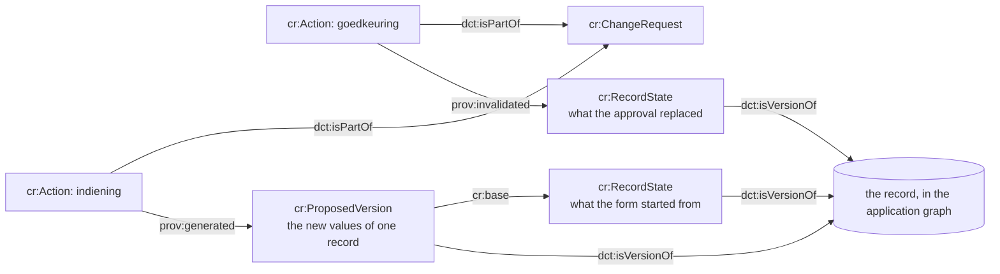

# What is stored

The vocabulary is `http://lblod.data.gift/vocabularies/change-requests/` (`cr:`), defined with its
alignments (⊑ `prov:Activity`, `prov:Entity`, `dct:subject`, `prov:wasDerivedFrom`, ...) in
[`vocabulary/change-requests.ttl`](../vocabulary/change-requests.ttl). Everything else reuses
standard terms. Requests, steps, versions, record states, links and errors live in the
change-requests graph; the records themselves in the application graph.

## Where things point



- **Request** (`cr:ChangeRequest`): `mu:uuid`, `dct:created`, `adms:status` (repeats the status of
  the last step, for lists and filters), `cr:aggregate`, `cr:target` (the organisation),
  `pav:createdBy` (the requesting organisation), `dct:creator` (the person), `dct:isReplacedBy`
  (the newer request that replaced it, when the service withdrew it).
- **Step** (`cr:Action`): `dct:isPartOf` the request, `dct:type` (indiening, goedkeuring, ...),
  `adms:status` (the status of the request after this step), `schema:position`,
  `prov:startedAtTime`, `prov:wasAssociatedWith` (a `foaf:Person` or the service URI
  `http://lblod.data.gift/services/change-request-service`), `cr:actingOrganisation`, `cr:rule`
  (the policy rule), `dct:description` (the reason), `prov:generated` (its versions, on the
  indiening), `prov:invalidated` (the states it replaced, on an apply), `task:error` (an
  `oslc:Error`, on a failed apply).
- **Proposed version** (`cr:ProposedVersion`): `dct:isVersionOf` the record, `cr:masterUuid` (also
  when the record is gone), `prov:generatedAtTime`, `cr:resourceType` (the JSON:API type),
  `cr:operation` (`as:Create`, `as:Update` or `as:Delete`: the markers LDES uses, as values, so a
  version does not become an activity), `cr:changesProperty` (the predicates it changes; a
  single-valued one loses its values before the new ones are written, a list merges, a tombstone
  lists every predicate of its type), `cr:base` (the state it started from), and the record's own
  predicates with the new values. Relationships point at record URIs, never at other versions. A
  version never carries the record's `rdf:type`.
- **Record state** (`cr:RecordState`): `dct:isVersionOf` the record, the record's own predicates
  with the values at that moment (no triple for an empty field), and for a deleted record
  `cr:incomingLink` → one `rdf:Statement` per link that pointed at it (`rdf:subject`,
  `rdf:predicate`, `rdf:object` the record). Two roles: the state a version started from
  (`cr:base`) and the state an apply replaced (`prov:invalidated`).
- **Error** (`oslc:Error`): `oslc:message`, `dct:created`, `dct:creator` (the service),
  `dct:references` (the request); the shape job-controller writes.
- **Stamps on the target**: `dct:modified` and `ext:lastModifiedBy` (the person who submitted the
  request) on every apply that changed something.

What follows from this without storing it: the old and the new value of every applied field (the
replaced state next to the version), and the conflicts an approval overrode (where the replaced
state differs from the base). A tombstone removes links to its record from the application data
only; the versions and states that name the record keep it, so the history stays whole.

The change-requests graph is not exported (no deltas, no LDES): a version is a proposal, partial
and maybe rejected, not the state of a record. A feed of the records' history would be made from
the application graph.

## URIs and code lists

| What | URI |
| --- | --- |
| request | `http://data.lblod.info/id/change-requests/<uuid>` |
| step | `http://data.lblod.info/id/change-request-actions/<uuid>` |
| proposed version | `http://data.lblod.info/id/proposed-versions/<uuid>` |
| record state | `http://data.lblod.info/id/record-states/<uuid>` |
| link | `http://data.lblod.info/id/record-links/<uuid>` |
| error | `http://redpencil.data.gift/id/jobs/error/<uuid>` |

The statuses (ingediend, informatie-gevraagd, goedgekeurd, afgehandeld, afgekeurd, ingetrokken,
mislukt) and the step types (indiening, informatievraag, informatieantwoord, goedkeuring,
afhandeling, afkeuring, betwisting, intrekking, hertoepassing, wijziging) are `skos:Concept`s with
UUID URIs under `http://lblod.data.gift/concepts/`, in two schemes under
`http://lblod.data.gift/concept-schemes/`. app-lokale-verkenner loads them with two migrations
(`20261015120000-add-change-request-code-lists`, `20261020120000-add-validation-flow-code-lists`);
the service knows their URIs (`constants.js`). `goedgekeurd` is the decision and `afgehandeld` the
applied state: an apply records a goedkeuring (the decision, by ABB or by the service) and an
afhandeling (the service's, which carries the states it replaced), in one update; a failed apply
leaves the afhandeling with status `mislukt`. A request to register a new organisation has the
organisation's URI, minted at submission, as its `cr:target`; the organisation enters the
application graph when the request is applied, so a listing reads its uuid and name from the
proposed version until then.

## Example

A request the service approved at once, with its two steps, its versions, the states they started
from and the state the approval replaced:

```turtle
@prefix cr: <http://lblod.data.gift/vocabularies/change-requests/> .
@prefix as: <https://www.w3.org/ns/activitystreams#> .

<http://data.lblod.info/id/change-requests/f6c30f3b-af3e-4f7f-8ec3-11ec48093b5f> a cr:ChangeRequest ;
  mu:uuid "f6c30f3b-af3e-4f7f-8ec3-11ec48093b5f" ;
  dct:created "2026-11-03T10:12:00Z"^^xsd:dateTime ;
  adms:status <http://lblod.data.gift/concepts/ca080d1f-f71c-4fe6-a4ed-a13fe1112989> ;   # goedgekeurd: the status of the last step
  cr:aggregate "organization-core-data" ;
  cr:target <http://data.lblod.info/id/bestuurseenheden/9a01f3e2-4c7b-4d2a-9f1e-0a1b2c3d4e5f> ;
  pav:createdBy <http://data.lblod.info/id/bestuurseenheden/9a01f3e2-4c7b-4d2a-9f1e-0a1b2c3d4e5f> ;   # the requesting organisation
  dct:creator <http://data.lblod.info/id/persoon/1e2f3a4b-5c6d-4e7f-8a9b-0c1d2e3f4a5b> .               # the person who submitted it

<http://data.lblod.info/id/change-request-actions/ad2a0163-101e-40cb-b4c7-f2df4b3e3fb9> a cr:Action ;
  mu:uuid "ad2a0163-101e-40cb-b4c7-f2df4b3e3fb9" ;
  dct:isPartOf <http://data.lblod.info/id/change-requests/f6c30f3b-af3e-4f7f-8ec3-11ec48093b5f> ;
  dct:type <http://lblod.data.gift/concepts/9ea4e33a-1745-4159-9a24-5706bad7ab38> ;      # indiening
  adms:status <http://lblod.data.gift/concepts/d57aff85-43ce-4bd0-b962-6bd1b1fbc4b6> ;   # ingediend: the status after this step
  schema:position 1 ;
  prov:startedAtTime "2026-11-03T10:12:00Z"^^xsd:dateTime ;
  prov:wasAssociatedWith <http://data.lblod.info/id/persoon/1e2f3a4b-5c6d-4e7f-8a9b-0c1d2e3f4a5b> ;
  cr:actingOrganisation <http://data.lblod.info/id/bestuurseenheden/9a01f3e2-4c7b-4d2a-9f1e-0a1b2c3d4e5f> ;
  cr:rule "own-organisation" ;                                                          # the canEdit rule that allowed it
  prov:generated <http://data.lblod.info/id/proposed-versions/a1429927-7641-4916-982d-73f09fdc3304>,
                 <http://data.lblod.info/id/proposed-versions/2df12eb4-7abf-4cc4-803c-d6a5cb133f04>,
                 <http://data.lblod.info/id/proposed-versions/f464c0c1-9f1a-4720-8f08-08b6c8fc89ee> .

<http://data.lblod.info/id/change-request-actions/36166629-4a16-4dcf-9eeb-1054baa34ee0> a cr:Action ;
  mu:uuid "36166629-4a16-4dcf-9eeb-1054baa34ee0" ;
  dct:isPartOf <http://data.lblod.info/id/change-requests/f6c30f3b-af3e-4f7f-8ec3-11ec48093b5f> ;
  dct:type <http://lblod.data.gift/concepts/bb2bb632-fc9f-41c6-a1eb-8f50e4008551> ;      # goedkeuring
  adms:status <http://lblod.data.gift/concepts/ca080d1f-f71c-4fe6-a4ed-a13fe1112989> ;   # goedgekeurd
  schema:position 2 ;
  prov:startedAtTime "2026-11-03T10:12:01Z"^^xsd:dateTime ;
  prov:wasAssociatedWith <http://lblod.data.gift/services/change-request-service> ;    # taken by the service
  cr:rule "always" ;                                                                    # the autoApprove rule
  prov:invalidated <http://data.lblod.info/id/record-states/4d4d58ca-b401-45e2-b124-f14e75824f01>,   # the states it replaced
                   <http://data.lblod.info/id/record-states/a25dd05e-c96b-41e1-ae8e-ff4b86d3983b> .

<http://data.lblod.info/id/proposed-versions/a1429927-7641-4916-982d-73f09fdc3304> a cr:ProposedVersion ;   # an update
  mu:uuid "a1429927-7641-4916-982d-73f09fdc3304" ;
  dct:isVersionOf <http://data.lblod.info/id/bestuurseenheden/9a01f3e2-4c7b-4d2a-9f1e-0a1b2c3d4e5f> ;
  cr:masterUuid "9a01f3e2-4c7b-4d2a-9f1e-0a1b2c3d4e5f" ;
  prov:generatedAtTime "2026-11-03T10:12:00Z"^^xsd:dateTime ;
  cr:resourceType "administrative-units" ;
  cr:operation as:Update ;
  cr:changesProperty skos:prefLabel, regorg:legalName ;       # the fields it changes
  cr:base <http://data.lblod.info/id/record-states/94bcda5d-416b-4535-b645-a1b031e1c8a7> ;
  skos:prefLabel "Stad Aalst" ;
  regorg:legalName "Stad Aalst" .

<http://data.lblod.info/id/record-states/94bcda5d-416b-4535-b645-a1b031e1c8a7> a cr:RecordState ;   # what the form started from
  mu:uuid "94bcda5d-416b-4535-b645-a1b031e1c8a7" ;
  dct:isVersionOf <http://data.lblod.info/id/bestuurseenheden/9a01f3e2-4c7b-4d2a-9f1e-0a1b2c3d4e5f> ;
  skos:prefLabel "Aalst" .                                    # no triple: the legal name was empty

<http://data.lblod.info/id/record-states/4d4d58ca-b401-45e2-b124-f14e75824f01> a cr:RecordState ;   # what the organisation held when it was applied
  mu:uuid "4d4d58ca-b401-45e2-b124-f14e75824f01" ;
  dct:isVersionOf <http://data.lblod.info/id/bestuurseenheden/9a01f3e2-4c7b-4d2a-9f1e-0a1b2c3d4e5f> ;
  skos:prefLabel "Aalst" .

<http://data.lblod.info/id/proposed-versions/2df12eb4-7abf-4cc4-803c-d6a5cb133f04> a cr:ProposedVersion ;   # a create: no cr:changesProperty, no base, nothing replaced
  mu:uuid "2df12eb4-7abf-4cc4-803c-d6a5cb133f04" ;
  dct:isVersionOf <http://data.lblod.info/id/contact-punten/c08c78e6-26b1-4b57-8604-28f90abc422d> ;
  cr:masterUuid "c08c78e6-26b1-4b57-8604-28f90abc422d" ;
  cr:resourceType "contact-points" ;
  cr:operation as:Create ;
  schema:email "info@aalst.be" ; … .

<http://data.lblod.info/id/proposed-versions/f464c0c1-9f1a-4720-8f08-08b6c8fc89ee> a cr:ProposedVersion ;   # a tombstone
  mu:uuid "f464c0c1-9f1a-4720-8f08-08b6c8fc89ee" ;
  dct:isVersionOf <http://data.lblod.info/id/contact-punten/c0ffee12-3456-4789-8abc-def012345678> ;
  cr:resourceType "contact-points" ;
  cr:operation as:Delete ;
  cr:changesProperty schema:email, schema:telephone, schema:contactType, locn:address, … ;     # every field of its type
  cr:base <http://data.lblod.info/id/record-states/3e22ab22-00ed-43a7-b74d-738cf75194a3> ; … .

<http://data.lblod.info/id/record-states/3e22ab22-00ed-43a7-b74d-738cf75194a3> a cr:RecordState ;   # the record as the delete started from it
  mu:uuid "3e22ab22-00ed-43a7-b74d-738cf75194a3" ;
  dct:isVersionOf <http://data.lblod.info/id/contact-punten/c0ffee12-3456-4789-8abc-def012345678> ;
  schema:email "loket@aalst.be" ;
  schema:contactType "Primary" ;
  cr:incomingLink <http://data.lblod.info/id/record-links/c907432b-539d-4b25-9f90-a7f8ab109263> .

<http://data.lblod.info/id/record-links/c907432b-539d-4b25-9f90-a7f8ab109263> a rdf:Statement ;   # the site linked it
  mu:uuid "c907432b-539d-4b25-9f90-a7f8ab109263" ;
  rdf:subject <http://data.lblod.info/id/vestigingen/77c2a4b6-1d3e-4f5a-8b9c-0d1e2f3a4b5c> ;
  rdf:predicate org:siteAddress ;
  rdf:object <http://data.lblod.info/id/contact-punten/c0ffee12-3456-4789-8abc-def012345678> .
```

The state the approval replaced for the tombstone (`a25d…`) has the shape of its base state, as the
contact point and its links were when it was deleted. A goedkeuring by ABB whose apply failed, and
an older request a newer one replaced:

```turtle
<http://data.lblod.info/id/change-request-actions/3e4825fa-0dcf-4a46-9e95-66edf24d4eb0> a cr:Action ;
  dct:type <http://lblod.data.gift/concepts/bb2bb632-fc9f-41c6-a1eb-8f50e4008551> ;      # goedkeuring
  adms:status <http://lblod.data.gift/concepts/b610e2dc-902c-4874-b65e-78b7f6411c05> ;   # mislukt
  prov:wasAssociatedWith <http://data.lblod.info/id/persoon/3a4b5c6d-7e8f-4a9b-8c1d-2e3f4a5b6c7d> ;   # ABB's person
  cr:actingOrganisation <http://data.lblod.info/id/bestuurseenheden/141d9d6b-54af-4d17-b313-8d1c30bc3f5b> ;
  cr:rule "abb-decides-all" ;
  task:error <http://redpencil.data.gift/id/jobs/error/0e85ca4a-4b6b-4954-8ba3-8b0bd7fe5cc0> ; … .

<http://redpencil.data.gift/id/jobs/error/0e85ca4a-4b6b-4954-8ba3-8b0bd7fe5cc0> a oslc:Error ;
  mu:uuid "0e85ca4a-4b6b-4954-8ba3-8b0bd7fe5cc0" ;
  oslc:message "…" ;
  dct:created "2026-11-04T09:00:01Z"^^xsd:dateTime ;
  dct:creator <http://lblod.data.gift/services/change-request-service> ;
  dct:references <http://data.lblod.info/id/change-requests/…> .

<http://data.lblod.info/id/change-requests/5e97…> dct:isReplacedBy <http://data.lblod.info/id/change-requests/f6c3…> .
```

## Example queries

Run these against Virtuoso itself (in the app-lokale-verkenner development stack: `http://localhost:8899/sparql`,
the form or `curl --data-urlencode query@file.rq`). Through the stack the change-requests graph is
not readable: only the service's scope has it, by design. Each query carries its own prefixes and
`FROM` lines, so it can be pasted as it is; replace `<request uuid>` and `<record uuid>` where they
appear. Labels (statuses, step types, organisations) come from the public graph, the data from the
change-requests graph. All of them pass the conductor's "strict checking of void variables".

### All requests, newest first

Add `FILTER(?targetName = "Aalst")` or `?request adms:status/skos:prefLabel "Ingediend"` to narrow.

```sparql
PREFIX cr:   <http://lblod.data.gift/vocabularies/change-requests/>
PREFIX mu:   <http://mu.semte.ch/vocabularies/core/>
PREFIX dct:  <http://purl.org/dc/terms/>
PREFIX adms: <http://www.w3.org/ns/adms#>
PREFIX pav:  <http://purl.org/pav/>
PREFIX skos: <http://www.w3.org/2004/02/skos/core#>
PREFIX foaf: <http://xmlns.com/foaf/0.1/>

SELECT ?uuid ?created ?status ?aggregate ?targetName ?requesterName ?person ?replacedBy
FROM <http://mu.semte.ch/graphs/change-requests>
FROM <http://mu.semte.ch/graphs/public>
WHERE {
  ?request a cr:ChangeRequest ;
    mu:uuid ?uuid ;
    dct:created ?created ;
    adms:status/skos:prefLabel ?status ;
    cr:aggregate ?aggregate ;
    cr:target/skos:prefLabel ?targetName ;
    pav:createdBy/skos:prefLabel ?requesterName ;
    dct:creator ?creator .
  OPTIONAL { ?creator foaf:firstName ?first ; foaf:familyName ?last }
  OPTIONAL { ?request dct:isReplacedBy/mu:uuid ?replacedBy }
  BIND(COALESCE(CONCAT(?first, " ", ?last), STR(?creator)) AS ?person)
}
ORDER BY DESC(?created)
```

### The steps of one request

Who did what, when, under which rule. The service shows as its URI.

```sparql
PREFIX cr:     <http://lblod.data.gift/vocabularies/change-requests/>
PREFIX mu:     <http://mu.semte.ch/vocabularies/core/>
PREFIX dct:    <http://purl.org/dc/terms/>
PREFIX adms:   <http://www.w3.org/ns/adms#>
PREFIX prov:   <http://www.w3.org/ns/prov#>
PREFIX schema: <http://schema.org/>
PREFIX skos:   <http://www.w3.org/2004/02/skos/core#>
PREFIX foaf:   <http://xmlns.com/foaf/0.1/>
PREFIX task:   <http://redpencil.data.gift/vocabularies/tasks/>
PREFIX oslc:   <http://open-services.net/ns/core#>

SELECT ?position ?type ?status ?at ?agent ?actingOrg ?rule ?reason ?error
FROM <http://mu.semte.ch/graphs/change-requests>
FROM <http://mu.semte.ch/graphs/public>
WHERE {
  ?request a cr:ChangeRequest ; mu:uuid "<request uuid>" .
  ?step a cr:Action ;
    dct:isPartOf ?request ;
    schema:position ?position ;
    dct:type/skos:prefLabel ?type ;
    adms:status/skos:prefLabel ?status ;
    prov:startedAtTime ?at ;
    prov:wasAssociatedWith ?agentUri .
  OPTIONAL { ?agentUri foaf:familyName ?agentName }
  OPTIONAL { ?step cr:actingOrganisation/skos:prefLabel ?actingOrg }
  OPTIONAL { ?step cr:rule ?rule }
  OPTIONAL { ?step dct:description ?reason }
  OPTIONAL { ?step task:error/oslc:message ?error }
  BIND(COALESCE(?agentName, STR(?agentUri)) AS ?agent)
}
ORDER BY ?position
```

### What one request proposes

One row per record and field: the value the form started from (`base`) and the proposed one. An
update or delete lists every field it changes (a cleared field has no `proposed`); a create lists
every value of the new record.

```sparql
PREFIX cr:   <http://lblod.data.gift/vocabularies/change-requests/>
PREFIX mu:   <http://mu.semte.ch/vocabularies/core/>
PREFIX dct:  <http://purl.org/dc/terms/>
PREFIX prov: <http://www.w3.org/ns/prov#>
PREFIX as:   <https://www.w3.org/ns/activitystreams#>
PREFIX rdf:  <http://www.w3.org/1999/02/22-rdf-syntax-ns#>

SELECT ?record ?recordType ?operation ?property ?base ?proposed
FROM <http://mu.semte.ch/graphs/change-requests>
WHERE {
  ?request a cr:ChangeRequest ; mu:uuid "<request uuid>" .
  ?submission a cr:Action ; dct:isPartOf ?request ; prov:generated ?version .
  ?version dct:isVersionOf ?record ; cr:resourceType ?recordType ; cr:operation ?operation .
  {
    ?version cr:changesProperty ?property .
    OPTIONAL { ?version cr:base ?baseState . ?baseState ?property ?base }
    OPTIONAL { ?version ?property ?proposed }
  }
  UNION
  {
    ?version cr:operation as:Create ; ?property ?proposed .
    FILTER(?property NOT IN (rdf:type, mu:uuid, dct:isVersionOf, cr:masterUuid,
                             prov:generatedAtTime, cr:resourceType, cr:operation))
  }
}
ORDER BY ?record ?property
```

### What an apply changed: old and new

The applying step (`prov:invalidated`) holds what the record held at that moment, the version what
replaced it. A list field shows whole lists on both sides; the apply merged them.

```sparql
PREFIX cr:   <http://lblod.data.gift/vocabularies/change-requests/>
PREFIX mu:   <http://mu.semte.ch/vocabularies/core/>
PREFIX dct:  <http://purl.org/dc/terms/>
PREFIX prov: <http://www.w3.org/ns/prov#>
PREFIX skos: <http://www.w3.org/2004/02/skos/core#>

SELECT ?stepType ?appliedAt ?record ?property ?old ?new
FROM <http://mu.semte.ch/graphs/change-requests>
FROM <http://mu.semte.ch/graphs/public>
WHERE {
  ?request a cr:ChangeRequest ; mu:uuid "<request uuid>" .
  ?apply a cr:Action ; dct:isPartOf ?request ;
    dct:type/skos:prefLabel ?stepType ;
    prov:startedAtTime ?appliedAt ;
    prov:invalidated ?state .
  ?state dct:isVersionOf ?record .
  ?submission a cr:Action ; dct:isPartOf ?request ; prov:generated ?version .
  ?version dct:isVersionOf ?record ; cr:changesProperty ?property .
  OPTIONAL { ?state ?property ?old }
  OPTIONAL { ?version ?property ?new }
}
ORDER BY ?record ?property
```

### The pending requests, with the live picture

Every request that waits for ABB, per field: its base, its proposal and what the record holds now.
A single-valued field is in conflict where `current` differs from both `base` and `proposed`. This
is what the service computes on every `GET`; it is not stored.

```sparql
PREFIX cr:   <http://lblod.data.gift/vocabularies/change-requests/>
PREFIX mu:   <http://mu.semte.ch/vocabularies/core/>
PREFIX dct:  <http://purl.org/dc/terms/>
PREFIX adms: <http://www.w3.org/ns/adms#>
PREFIX prov: <http://www.w3.org/ns/prov#>
PREFIX pav:  <http://purl.org/pav/>
PREFIX skos: <http://www.w3.org/2004/02/skos/core#>

SELECT ?uuid ?created ?requester ?record ?property ?base ?proposed ?current
FROM <http://mu.semte.ch/graphs/change-requests>
FROM <http://mu.semte.ch/graphs/public>
WHERE {
  ?request a cr:ChangeRequest ;
    mu:uuid ?uuid ;
    dct:created ?created ;
    adms:status/skos:prefLabel "Ingediend" ;
    pav:createdBy/skos:prefLabel ?requester .
  ?submission a cr:Action ; dct:isPartOf ?request ; prov:generated ?version .
  ?version dct:isVersionOf ?record ; cr:changesProperty ?property .
  OPTIONAL { ?version cr:base ?baseState . ?baseState ?property ?base }
  OPTIONAL { ?version ?property ?proposed }
  OPTIONAL { ?record ?property ?current }
}
ORDER BY ?created ?record ?property
```

### The whole history of one record

Every proposal, every base state and every state an apply replaced, also after the record was
deleted (hence `cr:masterUuid`, not the record's `mu:uuid`).

```sparql
PREFIX cr:   <http://lblod.data.gift/vocabularies/change-requests/>
PREFIX mu:   <http://mu.semte.ch/vocabularies/core/>
PREFIX dct:  <http://purl.org/dc/terms/>
PREFIX prov: <http://www.w3.org/ns/prov#>
PREFIX rdf:  <http://www.w3.org/1999/02/22-rdf-syntax-ns#>

SELECT ?when ?kind ?requestUuid ?property ?value
FROM <http://mu.semte.ch/graphs/change-requests>
WHERE {
  ?version cr:masterUuid "<record uuid>" ; dct:isVersionOf ?record .
  ?submission prov:generated ?version ; dct:isPartOf ?request .
  ?request mu:uuid ?requestUuid .
  {
    VALUES ?kind { "proposed" }
    ?version prov:generatedAtTime ?when ; ?property ?value .
    FILTER(?property NOT IN (rdf:type, mu:uuid, dct:isVersionOf, cr:masterUuid, prov:generatedAtTime,
                             cr:resourceType, cr:operation, cr:changesProperty, cr:base))
  }
  UNION
  {
    VALUES ?kind { "base: what the form showed" }
    ?version prov:generatedAtTime ?when ; cr:base ?state .
    ?state ?property ?value .
    FILTER(?property NOT IN (rdf:type, mu:uuid, dct:isVersionOf, cr:incomingLink))
  }
  UNION
  {
    VALUES ?kind { "replaced by the apply" }
    ?apply dct:isPartOf ?request ; prov:invalidated ?state ; prov:startedAtTime ?when .
    ?state dct:isVersionOf ?record ; ?property ?value .
    FILTER(?property NOT IN (rdf:type, mu:uuid, dct:isVersionOf, cr:incomingLink))
  }
}
ORDER BY ?when ?kind ?property
```

### Deleted records and who pointed at them

The links as they were when the delete was submitted (the `rdf:Statement`s on its base state).

```sparql
PREFIX cr:   <http://lblod.data.gift/vocabularies/change-requests/>
PREFIX mu:   <http://mu.semte.ch/vocabularies/core/>
PREFIX dct:  <http://purl.org/dc/terms/>
PREFIX prov: <http://www.w3.org/ns/prov#>
PREFIX as:   <https://www.w3.org/ns/activitystreams#>
PREFIX rdf:  <http://www.w3.org/1999/02/22-rdf-syntax-ns#>

SELECT ?requestUuid ?record ?recordType ?linkingRecord ?predicate
FROM <http://mu.semte.ch/graphs/change-requests>
WHERE {
  ?request mu:uuid ?requestUuid .
  ?submission dct:isPartOf ?request ; prov:generated ?version .
  ?version cr:operation as:Delete ; dct:isVersionOf ?record ; cr:resourceType ?recordType ; cr:base ?state .
  ?state cr:incomingLink ?link .
  ?link a rdf:Statement ; rdf:subject ?linkingRecord ; rdf:predicate ?predicate .
}
```

### Failed applies

```sparql
PREFIX cr:   <http://lblod.data.gift/vocabularies/change-requests/>
PREFIX mu:   <http://mu.semte.ch/vocabularies/core/>
PREFIX dct:  <http://purl.org/dc/terms/>
PREFIX prov: <http://www.w3.org/ns/prov#>
PREFIX skos: <http://www.w3.org/2004/02/skos/core#>
PREFIX task: <http://redpencil.data.gift/vocabularies/tasks/>
PREFIX oslc: <http://open-services.net/ns/core#>

SELECT ?requestUuid ?stepType ?at ?message
FROM <http://mu.semte.ch/graphs/change-requests>
FROM <http://mu.semte.ch/graphs/public>
WHERE {
  ?step a cr:Action ; dct:isPartOf ?request ; dct:type/skos:prefLabel ?stepType ;
    prov:startedAtTime ?at ; task:error ?error .
  ?request mu:uuid ?requestUuid .
  ?error a oslc:Error ; oslc:message ?message .
}
ORDER BY DESC(?at)
```

### Requests per status

```sparql
PREFIX cr:   <http://lblod.data.gift/vocabularies/change-requests/>
PREFIX adms: <http://www.w3.org/ns/adms#>
PREFIX skos: <http://www.w3.org/2004/02/skos/core#>

SELECT ?status (COUNT(?request) AS ?requests)
FROM <http://mu.semte.ch/graphs/change-requests>
FROM <http://mu.semte.ch/graphs/public>
WHERE { ?request a cr:ChangeRequest ; adms:status/skos:prefLabel ?status }
GROUP BY ?status
```

### Everything at once

One row per request × step × record × field (plus one per kept link). The step columns are filled
on every row; the record and field columns only on indiening rows (proposal with its base) and on
apply rows (old value in `replaced`, new in `proposed`, so an apply row reads as a diff). A step
without data (afkeuring, intrekking) gives one row with empty record columns. Uncomment the
`VALUES` line for one request; over a whole graph, page with `LIMIT`/`OFFSET` (Virtuoso cuts at
10 000 rows without a warning). Its shape follows the Virtuoso rules below.

```sparql
PREFIX cr:     <http://lblod.data.gift/vocabularies/change-requests/>
PREFIX mu:     <http://mu.semte.ch/vocabularies/core/>
PREFIX dct:    <http://purl.org/dc/terms/>
PREFIX adms:   <http://www.w3.org/ns/adms#>
PREFIX prov:   <http://www.w3.org/ns/prov#>
PREFIX pav:    <http://purl.org/pav/>
PREFIX schema: <http://schema.org/>
PREFIX skos:   <http://www.w3.org/2004/02/skos/core#>
PREFIX foaf:   <http://xmlns.com/foaf/0.1/>
PREFIX task:   <http://redpencil.data.gift/vocabularies/tasks/>
PREFIX oslc:   <http://open-services.net/ns/core#>
PREFIX as:     <https://www.w3.org/ns/activitystreams#>
PREFIX rdf:    <http://www.w3.org/1999/02/22-rdf-syntax-ns#>

SELECT ?requestUuid ?created ?requestStatus ?aggregate ?target ?requester ?submitter ?replacedBy
       ?position ?stepType ?stepStatus ?at ?who ?actingOrg ?rule ?reason ?errorAt ?errorMessage
       ?recordType ?recordUuid ?record ?operation ?property
       ?base ?baseLabel ?proposed ?proposedLabel ?replaced ?replacedLabel
       ?linkFrom ?linkPredicate
FROM <http://mu.semte.ch/graphs/change-requests>
FROM <http://mu.semte.ch/graphs/public>
WHERE {
  # VALUES ?requestUuid { "<request uuid>" }        # one request instead of all

  # --- the request --------------------------------------------------------------------------
  ?request a cr:ChangeRequest ;
    mu:uuid ?requestUuid ;
    dct:created ?created ;
    adms:status ?requestStatusConcept ;
    cr:aggregate ?aggregate ;
    cr:target ?targetUri ;
    pav:createdBy ?requesterUri ;
    dct:creator ?creator .
  OPTIONAL { ?requestStatusConcept skos:prefLabel ?requestStatus }
  OPTIONAL { ?targetUri skos:prefLabel ?target }
  OPTIONAL { ?requesterUri skos:prefLabel ?requester }
  OPTIONAL { ?creator foaf:firstName ?creatorFirst ; foaf:familyName ?creatorLast }
  OPTIONAL { ?request dct:isReplacedBy/mu:uuid ?replacedBy }
  BIND(COALESCE(CONCAT(?creatorFirst, " ", ?creatorLast), STR(?creator)) AS ?submitter)

  # --- its steps ----------------------------------------------------------------------------
  OPTIONAL {
    ?step a cr:Action ;
      dct:isPartOf ?request ;
      schema:position ?position ;
      dct:type ?stepTypeConcept ;
      adms:status ?stepStatusConcept ;
      prov:startedAtTime ?at ;
      prov:wasAssociatedWith ?agent .
    OPTIONAL { ?stepTypeConcept skos:prefLabel ?stepType }
    OPTIONAL { ?stepStatusConcept skos:prefLabel ?stepStatus }
    OPTIONAL { ?agent foaf:firstName ?agentFirst ; foaf:familyName ?agentLast }
    OPTIONAL { ?step cr:actingOrganisation/skos:prefLabel ?actingOrg }
    OPTIONAL { ?step cr:rule ?rule }
    OPTIONAL { ?step dct:description ?reason }
    OPTIONAL { ?step task:error ?error . ?error oslc:message ?errorMessage ; dct:created ?errorAt }
    BIND(COALESCE(CONCAT(?agentFirst, " ", ?agentLast), STR(?agent)) AS ?who)   # the service: its URI

    # --- the fields a step touched: one UNION, every branch walks the path from ?step -----------
    OPTIONAL {
      { # an indiening: a field a version changes, with the base the form showed
        ?step prov:generated ?version .
        ?version dct:isVersionOf ?record ;
          cr:masterUuid ?recordUuid ;
          cr:resourceType ?recordType ;
          cr:operation ?operation ;
          cr:changesProperty ?property .
        OPTIONAL { ?version ?property ?proposed . OPTIONAL { ?proposed skos:prefLabel ?proposedLabel } }   # empty: the field is cleared
        OPTIONAL { ?version cr:base ?baseState . ?baseState ?property ?base . OPTIONAL { ?base skos:prefLabel ?baseLabel } } }
      UNION
      { # an indiening: a value of a record a version creates
        ?step prov:generated ?version .
        ?version dct:isVersionOf ?record ;
          cr:masterUuid ?recordUuid ;
          cr:resourceType ?recordType ;
          cr:operation ?operation ;
          cr:operation as:Create ;
          ?property ?proposed .
        FILTER(?property NOT IN (rdf:type, mu:uuid, dct:isVersionOf, cr:masterUuid,
                                 prov:generatedAtTime, cr:resourceType, cr:operation))
        OPTIONAL { ?proposed skos:prefLabel ?proposedLabel } }
      UNION
      { # an indiening: a link that pointed at a record a version deletes
        ?step prov:generated ?version .
        ?version dct:isVersionOf ?record ;
          cr:masterUuid ?recordUuid ;
          cr:resourceType ?recordType ;
          cr:operation ?operation ;
          cr:base ?baseState .
        ?baseState cr:incomingLink ?link .
        ?link rdf:subject ?linkFrom ; rdf:predicate ?linkPredicate .
        VALUES ?property { cr:incomingLink } }
      UNION
      { # an apply (goedkeuring, hertoepassing, also a mislukt attempt): a field of a state it replaced,
        # next to the value the request put there
        ?step prov:invalidated ?state .
        ?state dct:isVersionOf ?record .
        ?step dct:isPartOf ?sameRequest . ?submission dct:isPartOf ?sameRequest ; prov:generated ?version .
        ?version dct:isVersionOf ?record ;
          cr:masterUuid ?recordUuid ;
          cr:resourceType ?recordType ;
          cr:operation ?operation ;
          cr:changesProperty ?property .
        OPTIONAL { ?state ?property ?replaced . OPTIONAL { ?replaced skos:prefLabel ?replacedLabel } }   # empty: the field was empty before
        OPTIONAL { ?version ?property ?proposed . OPTIONAL { ?proposed skos:prefLabel ?proposedLabel } } }
      UNION
      { # an apply: a link a delete removed
        ?step prov:invalidated ?state .
        ?state dct:isVersionOf ?record ;
          cr:incomingLink ?link .
        ?link rdf:subject ?linkFrom ; rdf:predicate ?linkPredicate .
        ?step dct:isPartOf ?sameRequest . ?submission dct:isPartOf ?sameRequest ; prov:generated ?version .
        ?version dct:isVersionOf ?record ;
          cr:masterUuid ?recordUuid ;
          cr:resourceType ?recordType ;
          cr:operation ?operation .
        VALUES ?property { cr:incomingLink } }
    }
  }
}
ORDER BY DESC(?created) ?requestUuid ?position ?recordType ?record ?property
```

### Virtuoso rules for report queries on this graph

Found by bisection on Virtuoso 7.20 (redpencil/virtuoso 1.4.0), each checked against ground-truth
counts of the rows a shape must return. Reproduce the conductor's behaviour over HTTP by prepending
`define sql:signal-void-variables 1` to the query.

- **`VALUES`, not `BIND`, for a constant inside a `UNION` branch** when the query has two `FROM`
  graphs: the conductor's strict checking rejects the `BIND` ("Variable `_::default_…` is used in
  subexpressions of the query but not assigned"). The same goes for `BIND(?a AS ?b)` when another
  branch does not bind `?a`: bind `?b` by a pattern in every branch instead.
- **Look a label up where the value is bound.** `OPTIONAL { ?x skos:prefLabel ?l }` at the top
  level, on a variable bound deep inside `OPTIONAL { UNION { OPTIONAL } }`, sends the cost estimate
  past the limit ("estimated execution time exceeds 400 s") while the real run takes under a
  second. Nest the lookup inside the `OPTIONAL` that binds the value.
- **No `{ SELECT * WHERE { … } }` around the nested part** to keep the labels outside: Virtuoso
  then silently drops values bound in nested `OPTIONAL`s and `UNION` branches (here 116 of 152
  create values). An explicit projection list does not help.
- **One `UNION`, every branch walking the whole path from the anchor.** A nested `OPTIONAL` in a
  branch does not see a variable bound outside the branch (the rows where the field was empty
  before vanish); two sibling `OPTIONAL`s that bind the same variables lose the bindings the second
  one makes; and naming a variable from two groups further out (`?request`) makes Virtuoso re-run
  the branch per row (0.5 s became 25 s), hence the local `?sameRequest`.
